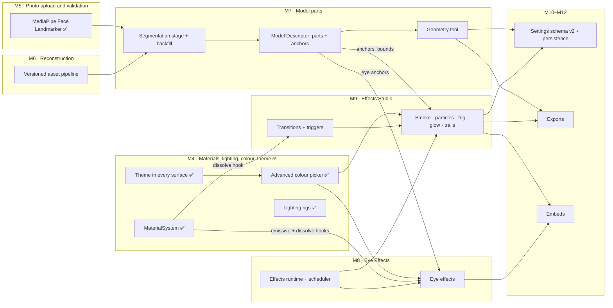

# Feature dependencies

How the planned features depend on each other and on milestones. Arrows point
from a prerequisite to what needs it. See ADR 0006 for the shared
architecture and `docs/specs/` for each feature.

| Feature                    | Hard prerequisites                                      | Soft / nice-to-have                                     |
| -------------------------- | ------------------------------------------------------- | ------------------------------------------------------- |
| Theme completion           | —                                                       | —                                                       |
| Colour picker              | Theme tokens (popover must be themed)                   | Viewer sampler for eyedropper fallback                  |
| Model parts                | Versioned pipeline (M6), MediaPipe (M5), descriptor     | Sample build labels (MakeHuman weights)                 |
| Eye effects                | Descriptor anchors (M7), effects runtime, colour picker | Eye meshes (sample), eyelid blend shapes for real blink |
| Effects Studio             | Effects runtime, colour picker, descriptor anchors      | Material dissolve hook (for Reveal)                     |
| Exports with parts/effects | Geometry tool, effects (PNG frame)                      | Video export (future)                                   |
| Embeds with effects        | Effects runtime as lazy chunk                           | Quality tiers                                           |

Order rationale: segmentation must run on real reconstruction output, so it
follows M6; eye effects need anchors that segmentation produces for
generated models, so effects follow M7. The colour picker is needed by
everything that has a colour and lands first, in M4.
